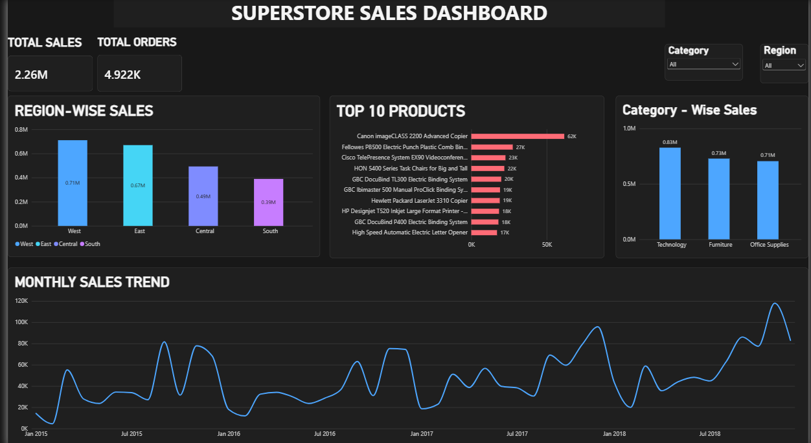

# Superstore Sales Analysis

End-to-end sales analysis of the Superstore dataset using **Excel, SQL (SQLite) and Power BI**, from data cleaning to an interactive dashboard and business recommendations.

## Dataset
- Superstore Sales Dataset from Kaggle: https://www.kaggle.com/datasets/rohitsahoo/sales-forecasting
- 9,800 order lines, 4,922 orders, from 2015 to 2018
- Key columns: Order Date, Region, Segment, Category, Sub-Category, Product Name, Sales
- Total sales: $2.26M

## Tools Used
- **Excel:** data cleaning, pivot tables, charts
- **SQL (SQLite):** aggregations, GROUP BY / HAVING, subqueries, INNER and LEFT JOINs
- **Power BI:** interactive dashboard with KPI cards, charts and slicers

## Approach
1. Cleaned the data in Excel and built pivot tables for region, category and monthly sales.
2. Imported the data into SQLite, split it into `customers` and `orders` tables, and wrote queries to answer business questions.
3. Built a Power BI dashboard with Total Sales and Total Orders cards, a region chart, a top 10 products chart, a monthly trend chart, and Region and Category slicers.
4. Documented findings, recommendations and user stories.

## Key Findings
- **Region:** West generates the most sales ($0.71M, about 31%); South is the lowest ($0.39M, about 17%).
- **Category:** Technology leads ($0.83M, 36.6%), but sales are fairly evenly spread across all three categories.
- **Time trend:** Annual sales grew from $479.9K (2015) to $722.1K (2018), about 50% growth, with a small dip in 2016. September to December account for about 52% of total sales.
- **Segment:** Consumer contributes about half of all sales (50.8%), followed by Corporate (30.4%) and Home Office (18.8%).

## Recommendations
1. Plan stock, staffing and marketing ahead of September to December.
2. Focus marketing on the Consumer segment and test campaigns in the South region.

Note: the dataset has no profit or cost data, so recommendations are based on sales only.

## Why JOINs
In real companies, data sits in separate tables (customers, orders, products). In this project I split the flat Superstore data into `customers` and `orders` tables and used INNER JOIN and LEFT JOIN to answer questions such as "Which customer segment generates the most sales?"

## Analysis Work
User stories with acceptance criteria are included in `insights_superstore.docx`, linking each dashboard feature to a user need (for example, a regional sales manager filtering by region).

## Files
| `superstore_analysis.xlsx` |- Excel pivots, formulas and charts 
| `QUERIES_1.sql`|- SQL queries with business-question comments 
| `superstore_dashboard.pbix` |- Power BI dashboard 
| `superstore_dashboard_ss.png` |-Dashboard screenshot 
| `insights_superstore.docx` | Findings, recommendations and user stories 
